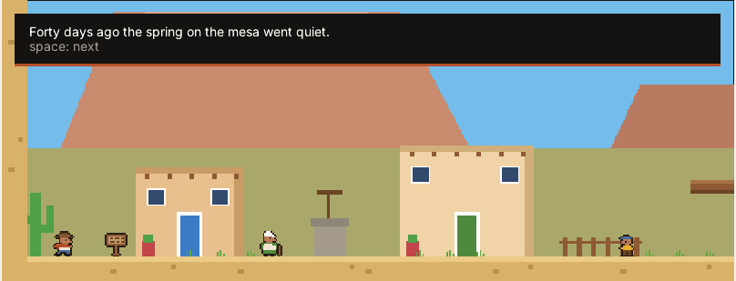
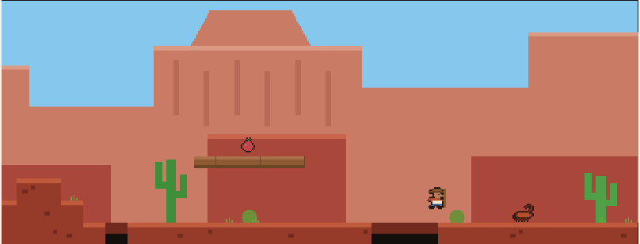
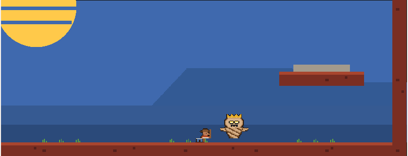
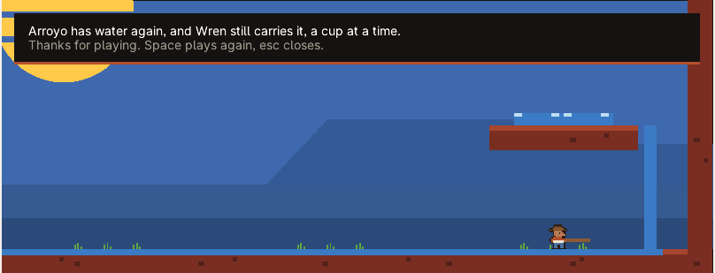

 

A small desert platformer that runs inside Joshua Tree, a computer built from scratch.

The spring on the mesa has gone quiet and the town of Arroyo is out of water. Wren takes Elder Pina's walking staff and climbs through a canyon, a cave and a salt flat to the Dust King, who is sitting on the spring.

**[mirage.jaybulb.com →](https://mirage.jaybulb.com)** Play it on the page.

## Features

- Five rooms, one story, about ten minutes: Arroyo, Red Canyon, the Cholla Caves, the Salt Flats and the Mesa.
- Our own pixel art, characters and story. Nothing borrowed.
- A native app in Joshua Tree on the PC build and the Raspberry Pi, and the same C compiled to WebAssembly for the landing.
- Played to the end by Duke, the games autopilot. Joshua Tree's checks replay Duke's run and must finish in the same spot on the host and in the OS.
- [The 20 second ad](landing/ad.mp4).

## Where the code lives

The game is part of Joshua Tree: [`user/mirage_core.h`](https://github.com/nulljosh/joshuatree/blob/main/user/mirage_core.h) is the world and the story, [`user/mirage.c`](https://github.com/nulljosh/joshuatree/blob/main/user/mirage.c) draws it. This repo holds the landing and the web build. `./build.sh` compiles those same files for the browser, and `./deploy.sh` ships the page.

## Play

| Key | |
|---|---|
| A and D, or the arrows | walk |
| W or Up | jump |
| Space | swing the staff |
| S, Down or Enter | talk, read a sign, turn the page |

On a phone the page shows buttons instead.
